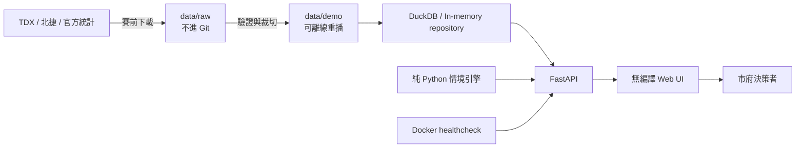

# TDD｜內科晨峰決策儀表板與公私協力接駁模擬器

文件類型：Technical Design Document  
狀態：Accepted for demo build  
決策日期：2026-10-13  
目標展示日：2026-10-24（星期六）  
主要觀眾：臺北市政府／黑客松評審

## 1. 決策摘要

本專案採用單一 Docker 容器，後端為 FastAPI，查詢層為 DuckDB，前端為無編譯的 HTML／CSS／JavaScript。正式展示讀取版控內的小型 demo 資料，TDX 更新是賽前作業，不是畫面啟動的必要條件。

產品不是只展示圖表，而是讓評審依序完成三個決策：

1. 找出 07:00–09:30 哪些 VD、道路與 15 分鐘區間壓力最高。
2. 比較分批上班、彈性工時、公私協力點對點接駁，以及組合方案。
3. 調整「可服務員工數、成功轉搭率、原運具、座位數與成本分攤」，立即得到車流紓解、班次、車隊及成本區間。

所有輸出都標成 `observed`、`derived` 或 `assumed`。接駁與工時方案是透明的情境投影，不宣稱為已校準的政策預測。

## 2. 目標與非目標

### 2.1 Demo 必須證明

- 儀表板可由公開資料離線重播一個完整平日晨峰。
- 市府可選道路與時間，查看 VD 流量、速度、狀態及資料品質。
- 成功說服多少人改搭接駁是顯式輸入，不藏在模型內。
- 能並排比較分批上班、彈性工時、接駁、接駁加優先通行與組合方案。
- 能回答「需幾班、幾輛、一天多少錢、由誰分攤、約少多少汽機車」。
- 結論可追到來源日期、公式及假設。

### 2.2 本週不做

- 個人層級 OD 推斷或員工住址追蹤。
- 經實證校準的運具選擇模型。
- 全臺北動態交通指派、路口微觀模擬或號誌最佳化。
- 訂票、金流、車輛即時派遣與正式採購流程。
- 把優先通行的時間節省直接宣稱為政策成效。

## 3. 使用者流程

首頁採單頁、三段式決策敘事：

1. **現在發生什麼事**：地圖、分鐘時間軸、15 分鐘曲線、資料品質。
2. **有哪些政策槓桿**：基準、分批上班、彈性工時、公私協力接駁、組合方案比較。
3. **如果說服 X% 會怎樣**：敏感性曲線、班次／車隊、每日成本及四方分攤。

預設展示劇本控制在 6–8 分鐘；進階假設收在可展開區域，避免主畫面被參數淹沒。

## 4. 資料契約

### 4.1 觀測資料

| 資料 | Demo 檔 | 粒度 | 用途 |
|---|---|---|---|
| VD 站點 | `data/demo/neihu_vd_stations.csv` | 56 個 VD | 位置、道路、LinkID |
| VD 歷史 | `data/demo/neihu_vd_2026-10-06_0700-0930.csv.gz` | 每分鐘、每 VD | 地圖與 15 分鐘基準 |
| 捷運 OD 摘要 | `data/demo/metro_od_to_neihu_weekday_am_202608_origin_summary.csv` | 來源站—西湖／港墘 | 接駁候選起點旁證 |

### 4.2 資料語意

- `volume_total` 是該 VD 各 link、lane、vehicle type 的回報流量加總。
- 15 分鐘流量為 15 個一分鐘值加總。
- 15 分鐘速度為有效車流量加權速度；無有效車流時保留空值。
- 多個 VD 加總稱為「選定偵測器車流通過量」，不是不重複車輛數。
- 情境中的「等效車輛減量」假設每個受影響旅次通過一個選定入口 VD，不與全市路網效果畫上等號。

完整來源、授權與限制見 `DATA_SOURCES.md`。

## 5. 系統架構



### 5.1 為何不用 Streamlit

Streamlit 適合快速分析，但本案需要清楚的市府決策敘事、緊密控制的版面、可解釋的互動順序與無框架感的公開頁面。FastAPI 加原生前端仍可在一週內完成，且不需要 Node 建置鏈。

### 5.2 為何是單容器

- Demo 資料小，不需要 PostgreSQL、Redis 或物件儲存。
- 減少現場啟動、網路、版本與服務相依故障。
- 同一映像可在本機、目前 Linux 主機或任一支援 Docker 的平台執行。

### 5.3 模組

```text
src/taas/
├── main.py          # HTTP API、靜態檔與啟動生命週期
├── repository.py    # DuckDB／CSV 載入、快照與聚合
├── scenarios.py     # 純函式政策與成本模型
├── schemas.py       # API 契約及輸入驗證
└── static/          # 無編譯前端與本地 vendor 資產
```

## 6. API 契約

| Method | Path | 用途 |
|---|---|---|
| GET | `/api/health` | 容器與資料就緒檢查 |
| GET | `/api/meta` | 日期、時間、走廊、資料血統與預設參數 |
| GET | `/api/traffic/snapshot` | 指定分鐘與走廊的 VD 點位 |
| GET | `/api/traffic/series` | 指定走廊的 15 分鐘聚合 |
| GET | `/api/demand/origins` | 往西湖／港墘的捷運來源站排行 |
| POST | `/api/scenarios/evaluate` | 基準加五種政策情境、成本與敏感性分析 |

所有錯誤回應採 FastAPI 標準 JSON；API schema 由 `/docs` 提供。情境 API 不讀寫外部系統，因此相同輸入必須得到相同輸出。

## 7. 情境模型

### 7.1 公私協力點對點接駁

```text
shuttle_riders = addressable_commuters × switch_rate

cars_removed = shuttle_riders × from_car_share / average_car_occupancy
motorcycles_removed = shuttle_riders × from_motorcycle_share
inbound_bus_trips = ceil(shuttle_riders / (seats × target_load_factor))

net_motor_vehicles_removed =
    cars_removed + motorcycles_removed - inbound_bus_trips
```

`from_car_share + from_motorcycle_share + from_transit_share = 1`。從原大眾運輸轉搭者不算道路減量。回送空車對反方向道路的影響另列限制，不偷偷忽略為社會淨效益。

車隊近似：

```text
vehicle_cycle_minutes = 2 × one_way_minutes + turnaround_minutes
fleet_required = ceil(inbound_bus_trips × vehicle_cycle_minutes / service_window_minutes)
daily_cost = fleet_required × assumed_daily_cost_per_bus
```

這是規劃量級，不取代業者排班或報價。

### 7.2 分批上班

把參與者原到班分布拆為三個固定 cohort，分別提早 30 分鐘、不變、延後 30 分鐘。總旅次大致不變，主要 KPI 是尖峰 15 分鐘降低量與移出展示窗的旅次數。

### 7.3 彈性工時

把參與者的到班時間分散到整個 07:00–09:30 時窗。它降低峰值但不預設消滅旅次，也不等同遠距工作。

### 7.4 組合方案

先對可參與員工重新分配到班時間，再扣除轉搭接駁的汽機車並加入接駁班次。不得把各方案百分比直接相加。

### 7.5 公私協力成本分攤

UI 提供三個可說明的 preset，四方比例總和必須為 100%：

| Preset | 市府 | 企業 | 業者投入／折讓 | 乘客 |
|---|---:|---:|---:|---:|
| 企業主導 | 10% | 65% | 10% | 15% |
| 均衡共擔 | 25% | 50% | 10% | 15% |
| 政策啟動 | 40% | 35% | 10% | 15% |

「業者投入」是示範假設，可能是折讓、保底風險或車隊投入；正式採購前必須以合約與報價替換。

## 8. UI 與視覺決策

- 語言：繁體中文，數字使用臺灣常見千分位與百分比。
- 視覺：深色交通控制台，以青色表示觀測、黃色表示假設、紫色表示組合方案、紅色表示壓力。
- 地圖：本地 Leaflet 程式碼＋OpenStreetMap 線上圖磚；圖磚失敗時仍顯示本地 SVG 點位層。
- 主畫面永遠顯示資料日期與 `觀測／衍生／假設` 圖例。
- 手機可讀，但展示優先最佳化為 1440×900 與 1920×1080。
- 不使用未驗證的效益口號或虛構案例。

## 9. 部署

### 9.1 Docker

```text
docker compose up --build -d
curl --fail http://127.0.0.1:8000/api/health
```

單一服務對外監聽 `0.0.0.0:8000`，設定 `restart: unless-stopped`。映像只包含 `data/demo`，不包含 `.env`、TDX 金鑰與 412 MiB 原始資料。

### 9.2 公開 URL

目前 Docker 部署是已決定的運行方式；網域、TLS 與防火牆屬主機層。若主機已有反向代理，就轉送至 `127.0.0.1:8000`；否則可先用臨時 HTTPS tunnel。公開前必須確認 `/api/health`、首頁與靜態資產都可由外網存取。

### 9.3 Secrets

- 展示容器不需要 TDX 金鑰。
- `.env` 不進映像、不進 Git、不由前端取得。
- 賽前更新資料的 collector 才讀取 `CLIENT_ID`／`CLIENT_SECRET`。

## 10. 可靠性與失敗模式

| 失敗 | 預防／降級 |
|---|---|
| TDX 限流或斷線 | 展示只讀固定 demo 資料 |
| OSM 圖磚失敗 | 顯示無底圖 SVG 與同一批 VD 點 |
| 原始大檔不存在 | 應用只依賴 `data/demo` |
| 某分鐘缺值 | 明確顯示資料完整率，不補成 0 |
| 輸入比例不合理 | Pydantic 拒絕，前端顯示可讀錯誤 |
| 成本資料尚未取得 | 黃色 `assumed` 標籤與可調輸入 |
| 現場操作失敗 | 預設值載入即可形成完整決策故事；保留錄影／截圖備援 |

## 11. 測試策略與驗收條件

### 11.1 自動測試

- 資料契約：56 個 VD、150 分鐘、8,400 個唯一鍵，時間為 07:00–09:29。
- 聚合：15 分鐘流量為分鐘流量加總；速度使用流量加權。
- 模型不變量：轉搭率增加時，接駁人數不得下降；零轉搭時接駁班次為零。
- 成本分攤總和等於總成本，容許四捨五入誤差。
- 政策曲線不得產生負車流。
- API：health、meta、snapshot、series、scenario 都回傳符合契約的 JSON。

### 11.2 Demo 驗收

- 冷啟動後 10 秒內 healthcheck 通過。
- 斷開外網後仍能操作時間軸、政策比較與敏感性分析。
- 任何方案都能在兩次點擊內回到預設值。
- 主畫面不出現 API key、個資或未標示的模擬數字。
- 1440×900 不需水平捲動即可完成主要展示流程。

## 12. 一週交付節點

| 日期 | 交付 |
|---|---|
| 10/13–10/14 | TDD、資料契約、單容器骨架、模型測試 |
| 10/15–10/17 | 車流地圖、時間軸、政策比較、敏感性圖 |
| 10/18–10/19 | 公私協力成本分攤、候選起點、說明文案 |
| 10/20 | 公開部署、HTTPS、外網 smoke test |
| 10/21 | 資料與公式審查、可及性與投影機畫面檢查 |
| 10/22 | 6–8 分鐘腳本、壓力測試、錄影備援 |
| 10/23 | 功能凍結，只修 blocker |
| 10/24 | Demo |

## 13. 已接受的架構決策

1. **FastAPI 而非 Streamlit**：換取更完整的產品感與可控敘事。
2. **無 Node 建置鏈**：降低本週整合風險。
3. **DuckDB／CSV.gz 而非 PostgreSQL**：資料是唯讀且小型。
4. **離線優先**：即時 API 是資料更新來源，不是展示依賴。
5. **直接輸入轉搭率**：沒有員工偏好調查前，不做偽精準的 Logit 校準。
6. **分批與彈性工時只改變時間分布**：不暗示總旅次消失。
7. **公私協力是營運與成本分攤模型**：不是聊天機器人，也不是既成 BOT 合約。

## 14. 非阻擋待辦

- 用 5–10 個正常工作日取代單日代表值。
- 取得 2–3 家遊覽車業者同規格報價。
- 取得企業匿名員工起點與偏好調查。
- 由交通專業人員人工確認 10–20 個入口 VD 的方向，建立不重複的 gateway screenline。
- 決定正式網域、TLS 與公開期間。
